# Рахунки юрособи в будь-який момент оренди

Клікабельний прототип флоу рахунків юрособи в картці оренди BP Space. Головна вимога брифу: менеджер виписує рахунок у будь-який момент оренди за кілька секунд і завжди бачить, які рахунки є, що з них оплачено і яка оплата до якого рахунку прив'язана.

Три варіанти (A, C і E) на сторінці проду стоять поруч із варіантом 0 — портом чинного проду, який служить антиреференсом і базою вимірів. Постановка — [BRIEF.md](BRIEF.md), відповіді замовника — [docs/questions.md](docs/questions.md), структури — [docs/shape.md](docs/shape.md).

**Публічне посилання:** https://yuliiariabchuk.github.io/bp-legal-invoices-prototype/

Відкрити одразу потрібний кадр: `?v=<0|A|C|E>&scene=<сцена>`, наприклад [A, сцена 6](https://yuliiariabchuk.github.io/bp-legal-invoices-prototype/?v=A&scene=five), [C, сцена 3](https://yuliiariabchuk.github.io/bp-legal-invoices-prototype/?v=C&scene=period), [C, десять рахунків](https://yuliiariabchuk.github.io/bp-legal-invoices-prototype/?v=C&scene=edge-ten).

## Запуск

```bash
npm install
```

```bash
npm run dev
```

Прототип відкривається на `http://localhost:5173/bp-legal-invoices-prototype/`.

**Віджет «Кадри»** у лівому нижньому куті перемикає:
- варіант;
- одну з 11 сцен брифу або крайній стан («Нуль рахунків», «Десять рахунків»);
- фізособу / юрособу (фізособа завжди показується чинним флоу проду);
- роль;
- етап.

Стан пишеться в URL, тож кадр відтворюється посиланням. `Ctrl+.` ховає віджет цілком; так зняті всі кадри нижче.

Прогін сцен і вимірів — `node scripts/walk.mjs` при запущеному `npm run dev`. Кадри для бізнесу — `node scripts/frames.mjs`, лягають у `shots/readme/`. Chrome шукається за платформою; інший шлях — `--chrome`.

## Варіанти

У прототипі три варіанти: чинний прод і два нові. В обох нових **сторінка та сама, що в проді**: шапка, степер, вертикальний рейл вузлів, «Нарахування та знижки», «Прийом коштів», «Реєстр платежів», «Видача», на «В роботі» — «Обладнання в оренді» і перехід до закриття, праворуч «Обладнання і термін», «Клієнт», «Розрахунки за орендою», «Застава», «Документи». Нові варіанти різняться тільки тим, **де живуть рахунки** і як показано продовження. Порівняння з іншими системами — [docs/shape.md](docs/shape.md), розділ 10.

### 0. Чинний прод — антиреференс

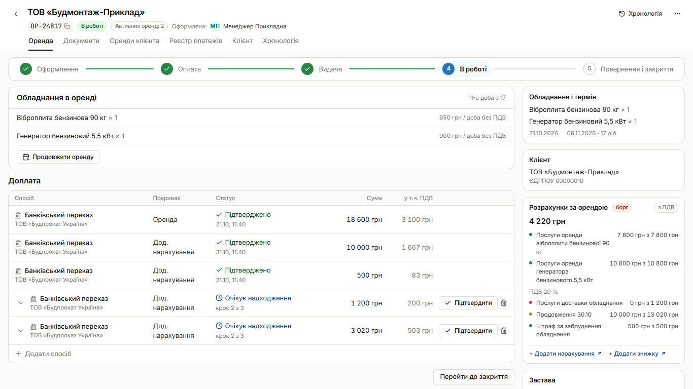

Рахунок живе в рядку «Банківський переказ» на кроці «Оплата» і створюється, коли виписують оплату:

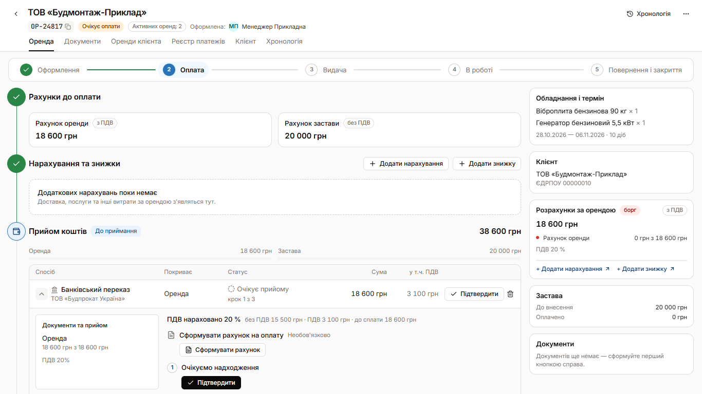

Новий рахунок посеред оренди — 6–7 кліків через інший етап. Номера рахунку біля платежу немає, тож на питання «яка оплата до якого рахунку» прод не відповідає. Сума до сплати друкується в чотирьох місцях одночасно. Вади портовано навмисно, критика — [docs/critique-v0.md](docs/critique-v0.md).

### A. Реєстр рахунків

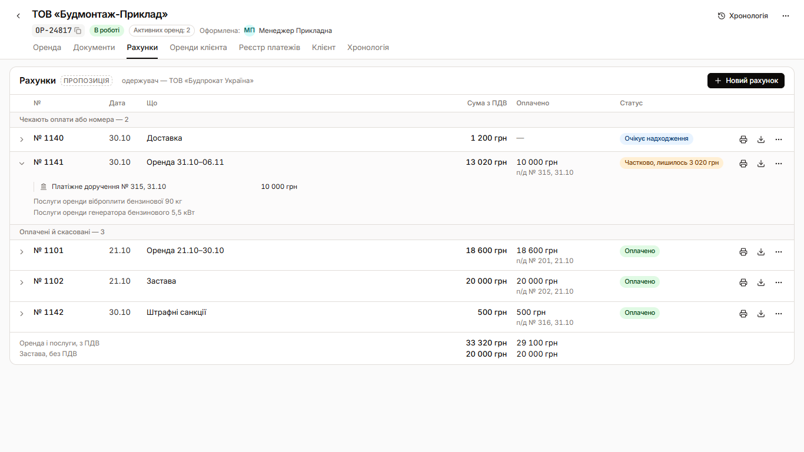

Нова вкладка «Рахунки» в шапці картки: таблиця всіх рахунків. Нагорі ті, що чекають оплати або номера, нижче журналом оплачені й скасовані. Розкритий рядок показує платіжки й склад. «+ Новий рахунок» — у цій вкладці; у рейлі поруч із «+ Додати нарахування» стоїть «+ Рахунок», що веде туди. На кроці «Оплата» сторінка проду без змін, лише під картками «Рахунок оренди» і «Рахунок застави» посилання на вкладку:

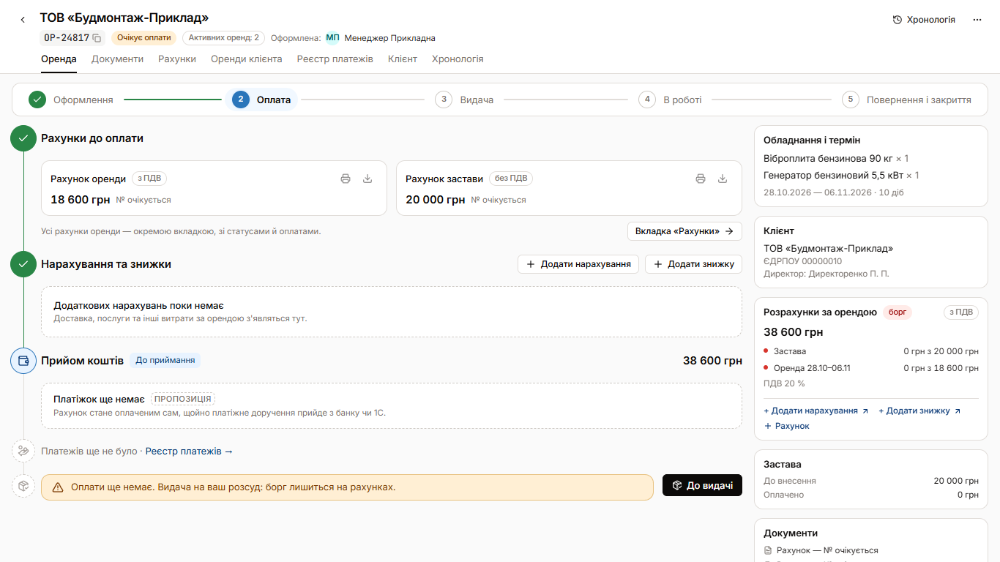

Кнопки «Продовжити оренду» для ЮЛ немає (BP-2307): на «В роботі» стоїть «грошей вистачить до» з розписаною формулою, а рахунок на нові доби виписується з реєстру:

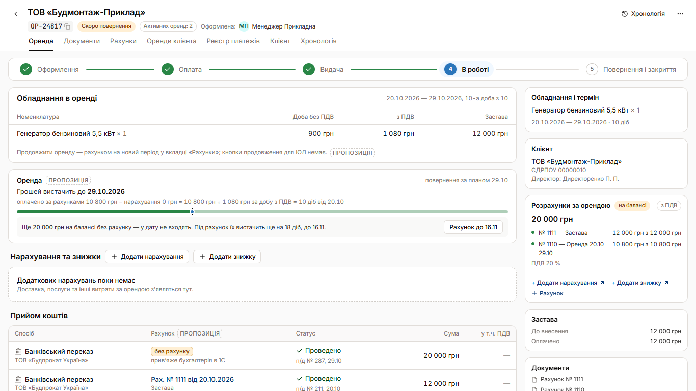

### C. Рахунки на кроці

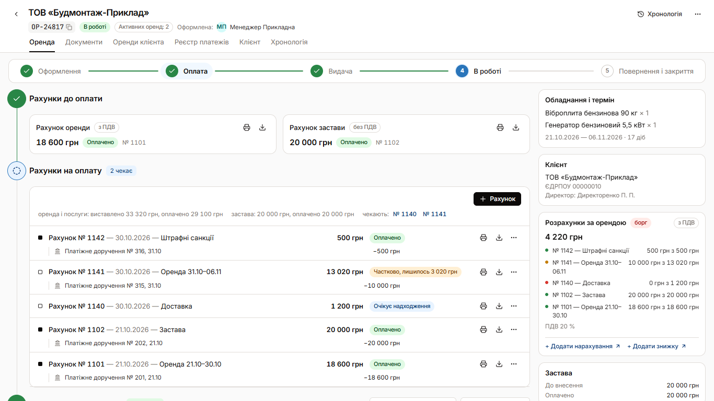

У вертикальний рейл вузлів кроку вставлено вузол «Рахунки на оплату», між «Рахунками до оплати» і «Нарахуваннями». Усі рахунки в ньому, свіжі зверху, кожен зі своїми платіжками; «+ Рахунок» там же, підказка наступного періоду стоїть над найсвіжішим рахунком оренди. На «В роботі» той самий блок стоїть над нарахуваннями, а над ним «грошей вистачить до» з розписаною формулою; кнопки продовження немає. У віджеті цей варіант раніше називався «Стрічка періодів»; стрічку на осі часу прибрано ще в переробці 03.11, бо вона ламала сторінку проду.

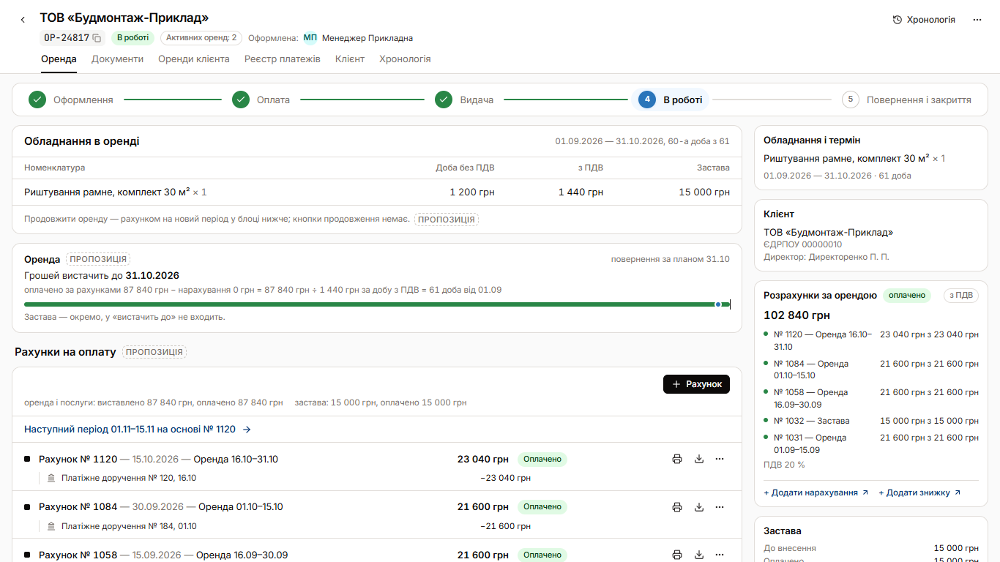

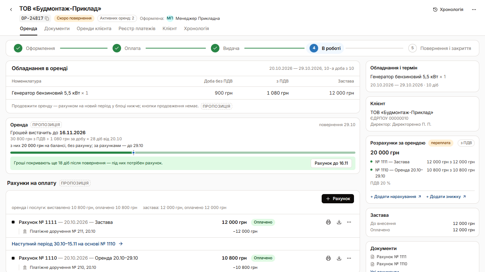

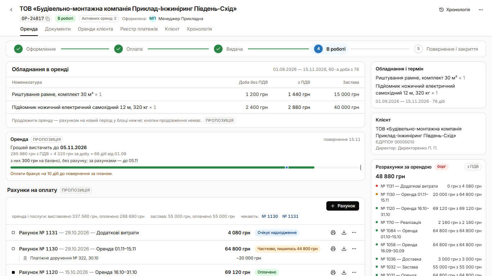

### E. Реєстр + швидкий бланк

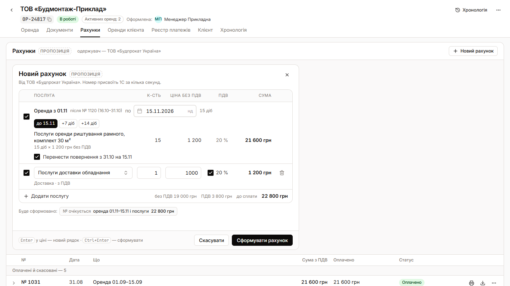

Той самий реєстр, що в A, але бланк нового рахунку з п'ятьма покращеннями *(пропозиція)*:
- **Ціна з довідника.** Послуга підставляє свою ціну без ПДВ (доставка 1 000, чистка 600…), застава — суму застав за позиціями. Ціну можна змінити.
- **Попередній рахунок поруч з орендою:** «після № 1120 (16.10–31.10)» — видно, на що спирається новий період.
- **Перетин періодів.** Якщо «по яке число» накриває доби, які вже є в іншому рахунку, бланк попереджає до формування.
- **Рахунки до формування:** «Буде сформовано: № очікується · оренда 01.11–15.11 і послуги · 22 800 грн». Застава — окремою плашкою, з орендою не сумується.
- **Клавіатура:** Enter у ціні — новий рядок і фокус на його послугу; Ctrl+Enter — сформувати.

На доставці (сцена 2) це на клік менше, ніж в A: ціну не треба друкувати.

### Спільне для A, C і E

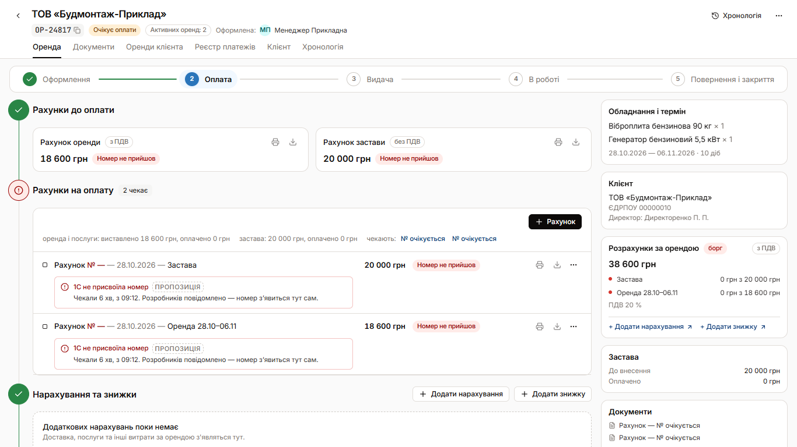

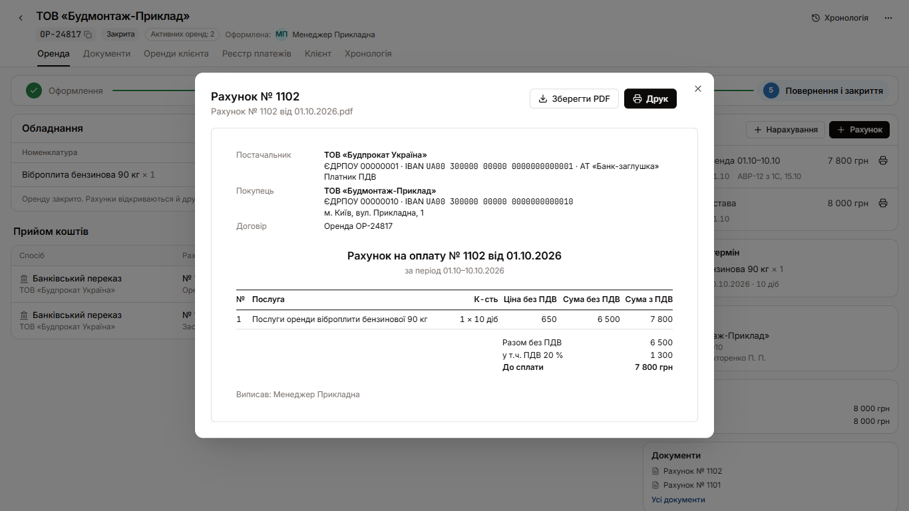

- **Бланк нового рахунку** — таблиця складу, як «Склад рахунку» в CRM і бланк 1С: «Послуга · К-сть · Ціна без ПДВ · ПДВ · Сума з ПДВ». Невиставлені нарахування стоять рядками з галочками, оренда за період — групою з полем «по», «+ Додати послугу» додає вільний рядок. Застава завжди окремим рахунком. Рахунок за доби після повернення пропонує перенести повернення.
- **Таблиця «Прийом коштів»** показує платіжки з банку чи 1С, а не чернетки способів *(пропозиція)*. Колонка «Рахунок» називає номер рахунку замість «Оренда / Застава».
- Оренда і застава створюються самі на переході «Оформлення → Оплата». Нічого саме не відкривається: рахунок відкривається на перегляд docked-панеллю праворуч, як документи в CRM, з «Друк» і «Зберегти PDF» з іменем `Рахунок № … від ….pdf`.
- **Стан «1С не присвоїла номер» — на самому рахунку.** Друк і PDF вимкнені, причина названа.
- **Неоплачений рахунок редагується, номер 1С лишається.** Скасувати можна в день створення, запис лишається закресленим з тим, хто і коли.
- **Кнопки «Підтвердити надходження» немає.** Статус змінює платіжне доручення з банку чи 1С.
- **Готівка від ЮЛ — ПКО на ФОП прямо з невиставленого нарахування.** Рахунки не змінюються.
- **«Документи» — дерево, як у 1С:** рахунок, під ним платіжки, АВР і видаткова.

## Виміри

Методика — §6 брифу, прогін `scripts/walk.mjs`, екран 1366×768.

| Вимір | 0 | A | C | E |
|---|---|---|---|---|
| Кліки до нового рахунку, сцена 2 (доставка) | 7 | 6 | 5 | 5 |
| Кліки до нового рахунку, сцена 3 (новий період) | 6 | 3 | 2 | 3 |
| Кліки до нового рахунку, сцена 4а (+7 діб) | 6 | 4 | 3 | 4 |
| Кліки до «яка оплата до якого рахунку», сцена 6 | — | 1 | 0 | 1 |
| Макс. зсув головної дії між кліками, px | 318 | 0 | 52 | 0 |
| Поверхні, що одночасно показують суму до сплати | 4 | 2 | 3 | 2 |
| Дій за згином | 1 | 0 | 2 | 0 |
| Горизонтальний скрол | немає | немає | немає | немає |

Як рахували:
- **Кліки** — до моменту, коли новий рахунок з'явився в стані. Послуга вибирається через пошуковий список, як у CRM (2 кліки), тож сцена 2 в A і C на клік довша, ніж до переходу на компоненти CRM. Очікування номера 1С не враховано. У варіанті 0 стаття витрат — нативний список за 1 клік, у проді комбобокс на 2, тож реальна сцена 2 там ≈ 8.
- **Відповідь сцени 6** зараховується, коли посилання «платіжка → № рахунку» відмальоване на сторінці. Прокрутка кліків не коштує.
- **Зсув у C (52 px)** — тільки в сцені 10: відкрита панель рахунку звужує сторінку, і блок рахунків перекомпоновується.
- **Дії за згином у C** — скасування рахунку і готівка за чистку: блок рахунків стоїть нижче «Обладнання» і «вистачить до».

Усі три нові варіанти (A, C, E) проходять усі 12 сцен без провалів. Варіант 0 провалює 13 перевірок: п'ять у сценах 4б–9 («вистачить до», «яка оплата до якого рахунку», «ким скасовано», «номер не прийшов», «АВР під рахунком») і всі вісім у сцені 12 — нічого з того, що BP-2060 пулить з 1С, прод не показує.

## Рекомендація

**Брати A за основу.** Головне місце рахунків — «Документи» з кнопкою «Додатковий рахунок», як чекає бізнес за [BP-2060](https://linear.app/tailored-tech/issue/BP-2060/yuo-rahunki-vidatkovi-j-avr-z-1s-v-orendi); воно вже є в обох варіантах. Вкладка «Рахунки» з A — зручний робочий список поверх «Документів». Продовження — без кнопки, з «грошей вистачить до», як уже зроблено в A і C.

**Аргументи.**
- **Тікет і синк 23.10 кажуть саме так:** «усі рахунки оренди лежать списком у «Документах» з номерами 1С, там же кнопка «Додатковий рахунок»», а продовження — «відображати, на скільки вистачить коштів, без кнопки» (рішення Саші, BP-2307).
- **A найспокійніший:** зсув 0, жодної дії за згином, сума до сплати у двох місцях, а не в трьох.
- **C швидший на кліках** (4 / 2 / 3, 0 до відповіді сцени 6), але тримає рахунки в потоці кроку: на «В роботі» дві дії лишаються нижче першого екрана.
- **Обидва варіанти тепер продовжують без кнопки** (BP-2307), тож вибір між ними — тільки місце списку рахунків.

## BP-2060: що де в прототипі

[BP-2060](https://linear.app/tailored-tech/issue/BP-2060/yuo-rahunki-vidatkovi-j-avr-z-1s-v-orendi) розбитий на чотири підтікети. Нижче — кожен крок, де його побачити і чи він є. Сцена 12 «Документи з 1С» зібрана саме під те, що приходить з 1С.

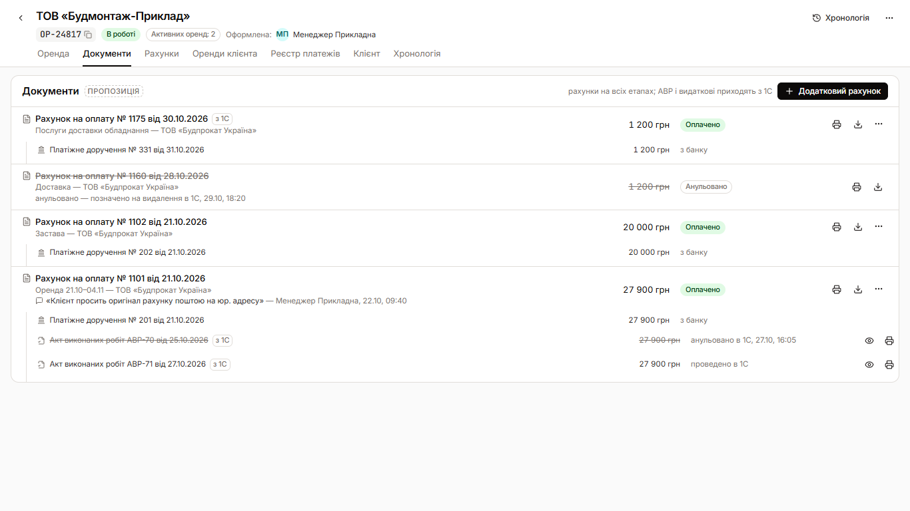

| Підтікет | Крок | Де в прототипі | Стан |
|---|---|---|---|
| [BP-2298](https://linear.app/tailored-tech/issue/BP-2298/rahunok-yul-okremij-dokument-push-i-pul-z-1s) рахунок ЮЛ | 1. Рахунок — окремий документ, не частина способу оплати | A: вкладка «Рахунки»; C: вузол на кроці; обидва — «Документи» | ✅ |
| | 2. Пуш в 1С, номер і дата з 1С, рахунок у «Документах» | Сцена 1 | ✅ (номер через ≈8 с, таймер) |
| | 3. Рахунок, створений в 1С, пулиться в «Документи» | Сцена 12, № 1175 з позначкою «з 1С» | ✅ |
| | 4. «Очікуємо № від 1С», друк недоступний | Сцени 1 і 8 | ✅ |
| | 5. Позначений в 1С на видалення → «анульовано» | Сцена 12, № 1160 | ✅ |
| | 6. Друк з «Документів» на будь-якому етапі; відкрити у Word, завантажити, переформувати | Панель рахунку праворуч, сцена 10 | ✅ «Відкрити у Word» у прототипі завантажує .doc з бланком |
| | 7. Коментар до рахунку для менеджера | Панель рахунку → «Коментар»; у списках рядком під рахунком; сцена 12, № 1101 | ✅ |
| [BP-2307](https://linear.app/tailored-tech/issue/BP-2307/prodovzhennya-orendi-yul-novij-rahunok-i-vistachit-do) продовження | 1. Без кнопки «Продовжити оренду» для ЮЛ, у ФО лишається | A і C: кнопки немає; ФО показана варіантом 0 з кнопкою | ✅ |
| | 2. Продовження — новим рахунком на потрібні доби | Сцени 3 і 4а: бланк з «по яке число» | ✅ |
| | 3–5. «Вистачить до <дата>» з розписаною формулою | A і C на «В роботі», сцена 4б | ✅ |
| [BP-2299](https://linear.app/tailored-tech/issue/BP-2299/vidatkova-i-avr-yul-pul-z-1s-u-dokumenti) видаткова і АВР | 1–3. Тільки пул з 1С, під своїм рахунком | «Документи», сцени 9 і 12 | ✅ |
| | 4. Перегляд і друк | Іконки біля АВР і видаткової → панель | ✅ |
| | 5. Позначений на видалення → «анульовано» | Сцена 12, АВР-70 | ✅ |
| | 6. Реалізація не потрапляє в «Продажі» (регрес BP-2250) | — | поза прототипом: екрана «Продажі» немає |
| [BP-2308](https://linear.app/tailored-tech/issue/BP-2308/reyestr-platezhiv-yul-nomer-i-data-rahunku-bilya-oplati) реєстр платежів | 1–2. «Рах. № 1102 від 30.10.2026» біля оплати, зв'язок з 1С | Вкладка «Реєстр платежів»; також «Прийом коштів» на кроці | ✅ |
| | 3. Не прив'язана оплата — «без рахунку» | Сцени 4б і 12 | ✅ |
| | 4. Клік по номеру відкриває рахунок у «Документах» | Будь-який «Рах. № …» → «Документи», рядок підсвічено | ✅ |
| | 5. Готівка ЮЛ і реєстр ФО без змін | ПКО в реєстрі як є, сцена 11 | ✅ |

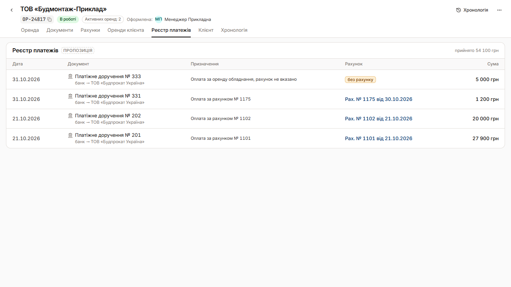

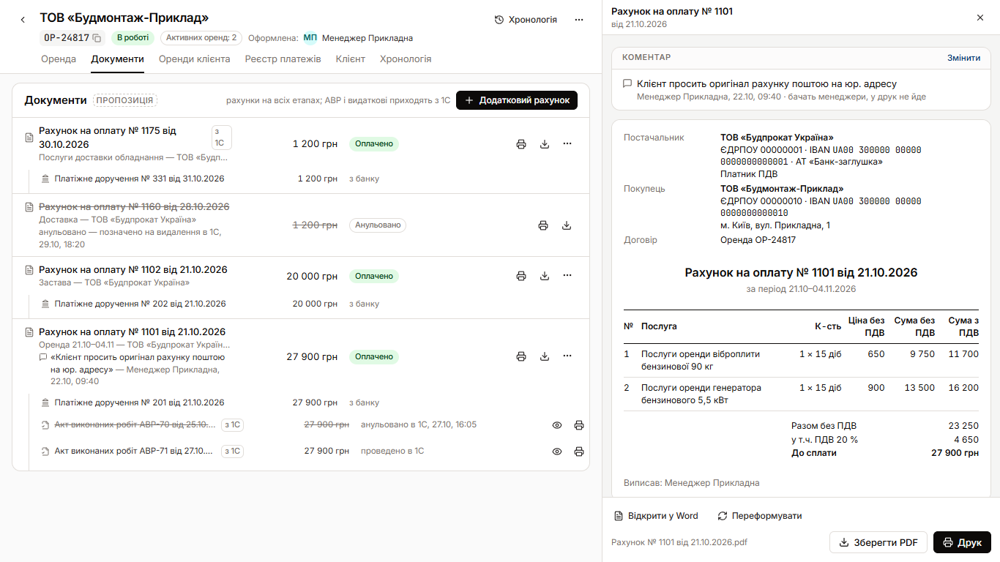

**Чого в прототипі немає і чому:**
- **Кнопка «Сформувати рахунок», як на ФО** (синк 23.10). Прототип створює оренду і заставу сам на переході до оплати — так ти відповіла 28.10 (D1). Ці два рішення треба звести в одне.
- **Скасування оренди з уже оплаченим рахунком і перев'язка рахунку на нову оренду** (синк 23.10). Рішення бізнесу немає, тікет позначає це «уточнюється».
- **Справжній Word і версії PDF.** «Відкрити у Word» завантажує .doc з бланком, «Переформувати» лише підіймає номер версії.

## Словник

| Термін | Що означає в прототипі |
|---|---|
| **Рахунок (на оплату)** | Документ 1С з номером, на який клієнт платить. Батьківський документ у дереві: під ним платіжки, АВР, видаткова. Тільки цей смисл |
| **Обліковий рахунок оренди** | Баланс оренди: «Оренда» і «Застава». Не документ і не рахунок на оплату; у прототипі не називається «рахунком» |
| **Нарахування** | Стаття, що збільшує суму оренди: доставка, чистка, штраф, додаткові витрати. Стає рядком рахунку або закривається готівкою |
| **Не виставлено** | Нарахування, якого ще немає в жодному чинному рахунку |
| **Застава (гарантійний платіж)** | Окремий рахунок без ПДВ з однією послугою. З орендою не сумується ніде |
| **Платіжне доручення (п/д)** | Гроші клієнта з банку чи 1С. Тільки воно змінює статус рахунку |
| **На балансі** | Гроші без рахунку: нерозпізнана платіжка або переплата. Прив'язує бухгалтерія |
| **№ очікується / Номер не прийшов** | 1С ще не присвоїла номер (≈8 с) / не присвоїла за 6 хв. Без номера рахунок не друкується |
| **Частково, лишилось X** | По рахунку є платіжки, але менше за суму |
| **АВР / видаткова** | Документи бухгалтерії з 1С: АВР під послуги, видаткова під реалізацію. BP Space їх лише показує |
| **ПКО** | Прибутковий касовий ордер: готівка від юрособи на ФОП. Рахунків не змінює |
| **Наступний період** | Рахунок оренди на основі попереднього: ті самі рядки, нові доби. Межа за ритмом 15/30 |
| **Продовження (а) / (б)** | (а) кнопка «Продовжити оренду» виписує рахунок; (б) кнопки немає, система каже, до якої дати вистачить грошей |
| **Пропозиція** | Пунктирна позначка в інтерфейсі: цього немає в проді |

## Пропозиції

Усе нижче нове відносно проду; в інтерфейсі позначене «пропозиція» з підказкою.

1. Оренда і застава створюються автоматично на переході до оплати; друк стає доступним, щойно прийде номер. Нічого саме не відкривається.
2. Рахунок виписується окремою дією на будь-якому етапі, і його місце в картці постійне (вкладка «Рахунки» в A, вузол на кроці в C).
3. Бланк рахунку: галочки на невиставленому, вільний рядок як у 1С, «по яке число», застава окремим рахунком.
4. Рахунок на наступний період на основі попереднього, межа за ритмом 15/30, підказка за 3 доби до кінця виставленого.
5. Рахунок за доби після повернення пропонує перенести повернення.
6. Продовження (а) одразу виписує рахунок на нові доби; продовження (б) показує «вистачить до» з розрахунком і окремим балансом.
7. Платіжка називає свій рахунок — скрізь, де видно гроші.
8. Статуси: «№ очікується», «Номер не прийшов» (стан на рахунку), «Частково, лишилось X», «Переплата X на балансі», «Скасовано» з тим, хто і коли.
9. Скасування — дія на рахунку в день створення, з коментарем за бажанням.
10. Кнопки «Підтвердити надходження» немає; видача без гейтів, лише попередження.
11. Готівка від ЮЛ закриває нарахування прямо з «Не виставлено» — ПКО на ФОП.
12. «Документи» — дерево, як у 1С; АВР і видаткова під своїм рахунком.
13. «Зберегти PDF» з іменем `Рахунок № 1102 від 30.10.2026.pdf`.

## Відкриті питання

- **«Вистачить до»: яку дату вважати головною?** Показано обидві: з урахуванням грошей на балансі і тільки за рахунками. G2 говорить про платіжки по рахунках оренди; у сцені 4б 20 000 лягли на баланс без рахунку.
- **Формула Бірізана (G2: «напевно»).** У прототипі «гроші ÷ ставка за добу з ПДВ», нарахування не віднімаються. Потрібна звірка з оригіналом формули.
- **Константи ритму:** поріг підказки (3 доби) і найкоротший запропонований період (7 діб).
- **Правка неоплаченого рахунку з тим самим номером 1С.** Що з PDF, уже надісланим клієнту (F1)? У прототипі є лише примітка «надішліть новий PDF».
- **Номер не прийшов: хто отримує сигнал крім менеджера** і що він каже клієнтові, який чекає PDF (B6, F9).
- **Фізособа показана портом варіанта 0 з готівкою в касі** і з реальним флоу ФО на проді не звірена.

## Структура

- `src/variants/{v0,a,c}` — варіанти; `src/variants/shared` — спільне для A і C: сторінка проду зі слотами (`ProdPage`, `ProdRail`), бланк, деталі рахунку.
- `src/domain` — гроші й рахунки: один розрахунок на всі варіанти.
- `src/mock` — сцени як стан.
- `src/lab` — віджет «Кадри».
- `docs/` — питання, shape (з порівнянням систем), критика варіанта 0.
- `DESIGN.md` — копія системного файлу CRM, візуальний світ не змінювався.
- Реквізити, назви й номери — заглушки, репа публічна.
