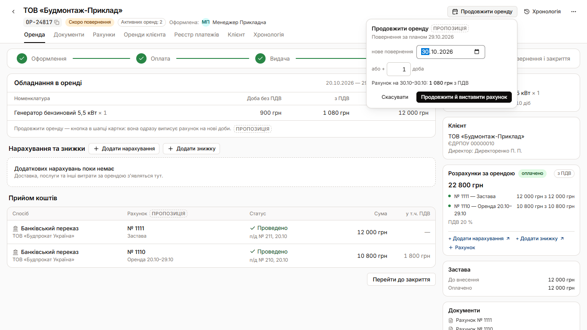
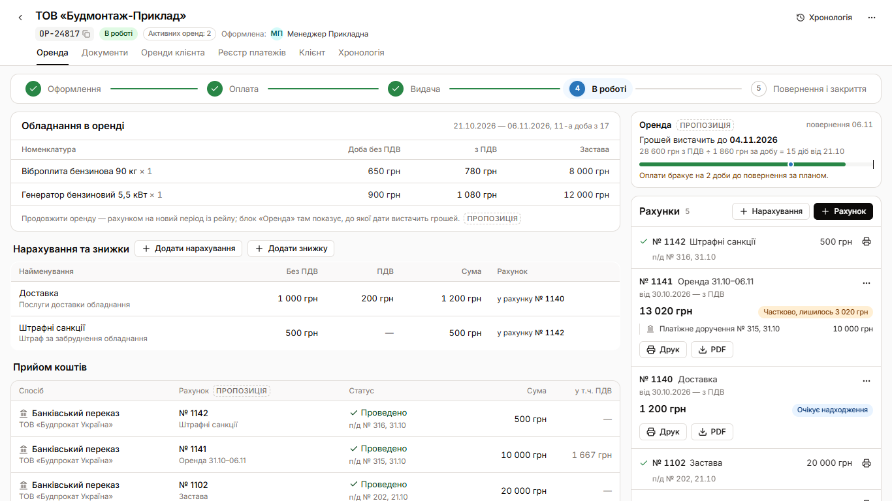
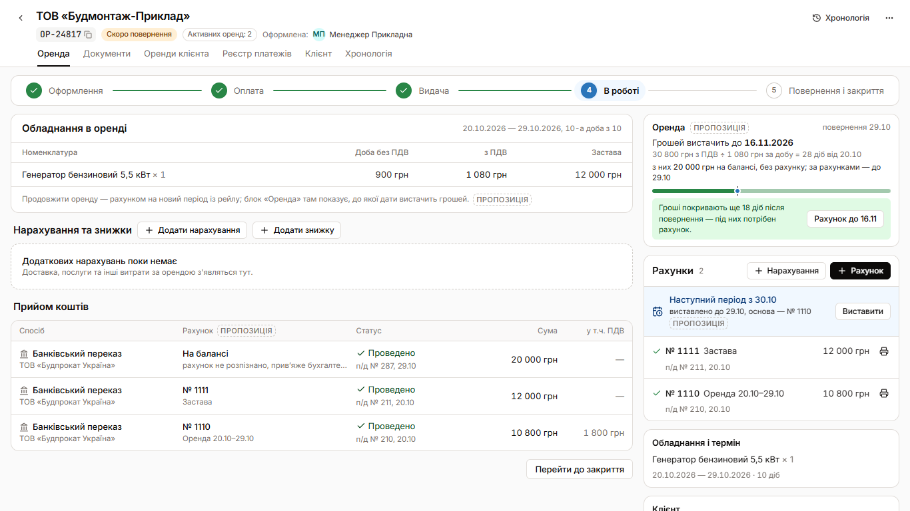
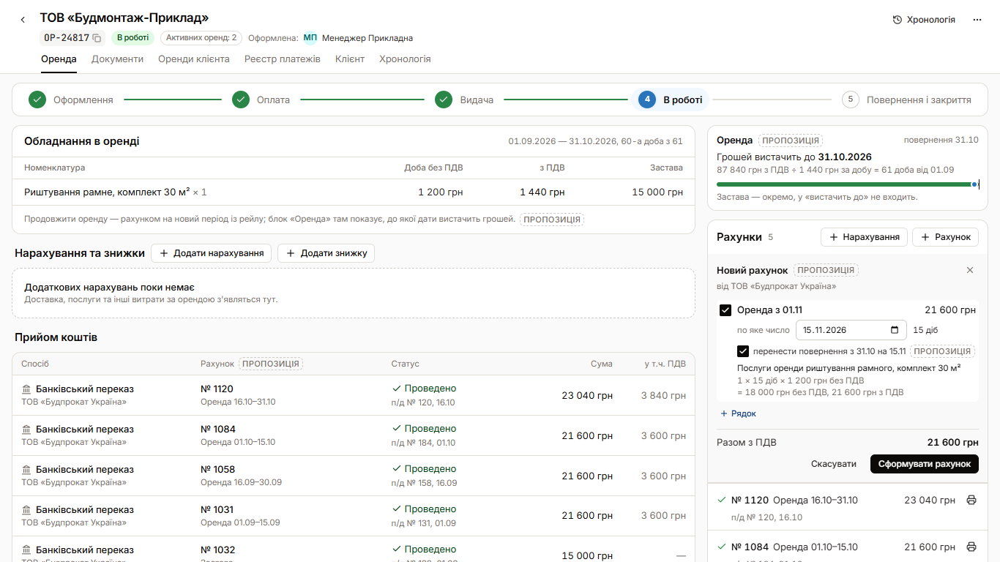
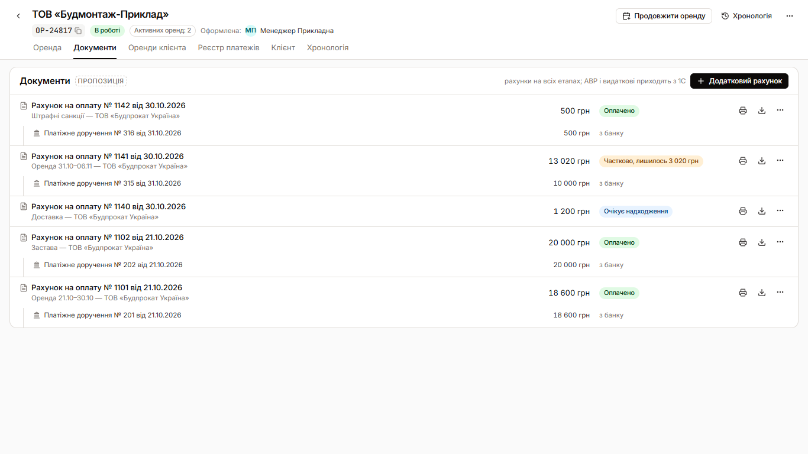
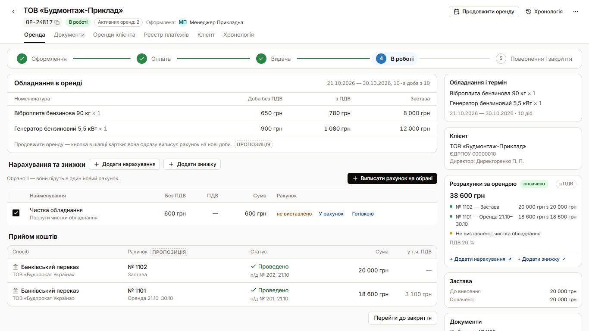
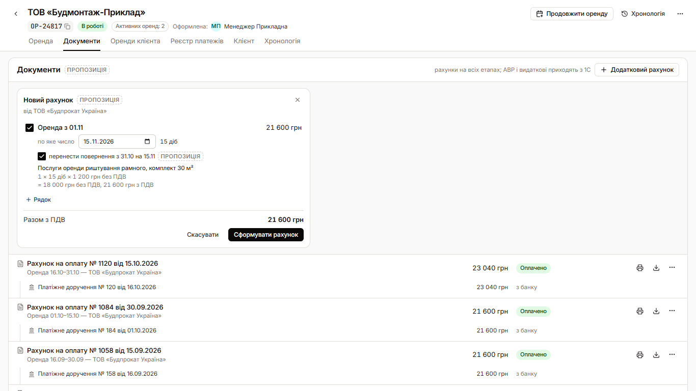
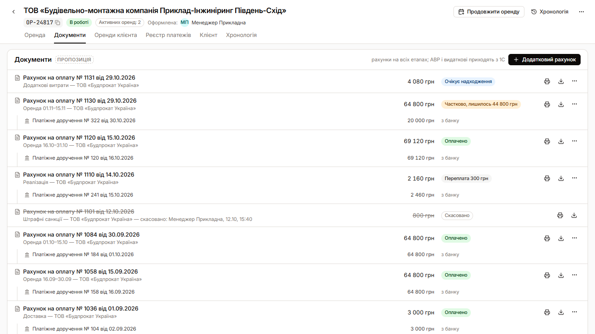
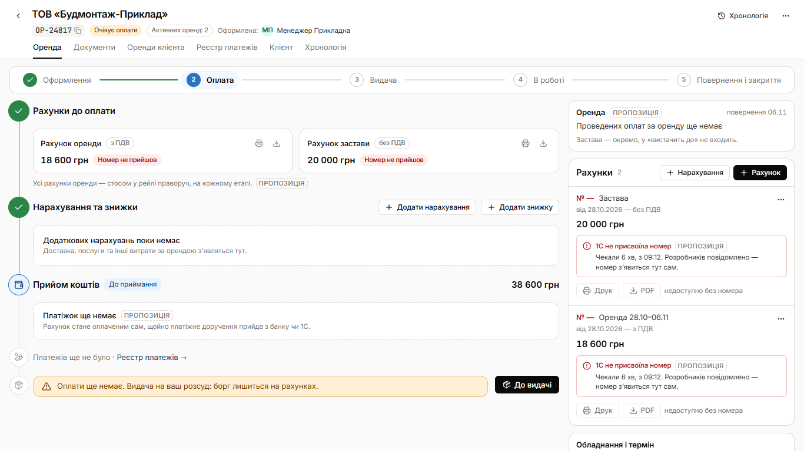

# Рахунки юрособи в будь-який момент оренди

Клікабельний прототип флоу рахунків юрособи в картці оренди BP Space. Головна вимога брифу: менеджер виписує рахунок у будь-який момент оренди за кілька секунд і завжди бачить, які рахунки є, що з них оплачено і яка оплата до якого рахунку прив'язана.

Чотири варіанти (A–D) на сторінці проду стоять поруч із варіантом 0 — портом чинного проду, який служить антиреференсом і базою вимірів. Постановка — [BRIEF.md](BRIEF.md), відповіді замовника — [docs/questions.md](docs/questions.md), структури — [docs/shape.md](docs/shape.md).

**Публічне посилання:** https://yuliiariabchuk.github.io/bp-legal-invoices-prototype/

Відкрити одразу потрібний кадр: `?v=<0|A|B|C|D>&scene=<сцена>`, наприклад [B, сцена 6](https://yuliiariabchuk.github.io/bp-legal-invoices-prototype/?v=B&scene=five), [D, сцена 11](https://yuliiariabchuk.github.io/bp-legal-invoices-prototype/?v=D&scene=cash), [C, десять рахунків](https://yuliiariabchuk.github.io/bp-legal-invoices-prototype/?v=C&scene=edge-ten).

## Запуск

```bash
npm install
```

```bash
npm run dev
```

Прототип відкривається на `http://localhost:5173/bp-legal-invoices-prototype/`.

**Віджет «Кадри»** у лівому нижньому куті перемикає:
- варіант;
- одну з 11 сцен брифу або крайній стан («Нуль рахунків», «Десять рахунків»);
- фізособу / юрособу (фізособа завжди показується чинним флоу проду);
- роль;
- етап.

Стан пишеться в URL, тож кадр відтворюється посиланням. `Ctrl+.` ховає віджет цілком; так зняті всі кадри нижче.

Прогін сцен і вимірів — `node scripts/walk.mjs --variants 0,A,B,C,D` при запущеному `npm run dev`. Кадри для бізнесу — `node scripts/frames.mjs`, лягають у `shots/readme/`. Chrome шукається за платформою; інший шлях — `--chrome`.

## Варіанти

У всіх чотирьох нових варіантів **сторінка та сама, що в проді** (варіант 0): шапка, степер, вертикальний рейл вузлів, «Нарахування та знижки», «Прийом коштів», «Реєстр платежів», «Видача», на «В роботі» — «Обладнання в оренді» і перехід до закриття, праворуч «Обладнання і термін», «Клієнт», «Розрахунки за орендою», «Застава», «Документи». Варіанти різняться тільки тим, **де живуть рахунки і як виписати новий**. Порівняння з іншими системами — [docs/shape.md](docs/shape.md), розділи 9–10.

### 0. Чинний прод — антиреференс


Рахунок живе в рядку «Банківський переказ» на кроці «Оплата» і створюється, коли виписують оплату:


Новий рахунок посеред оренди — 6–7 кліків через інший етап. Номера рахунку біля платежу немає, тож на питання «яка оплата до якого рахунку» прод не відповідає. Сума до сплати друкується в чотирьох місцях одночасно. Вади портовано навмисно, критика — [docs/critique-v0.md](docs/critique-v0.md).

### A. Вкладка «Рахунки» — продовження (а)


Нова вкладка в шапці картки: таблиця всіх рахунків. Нагорі ті, що чекають оплати або номера, нижче журналом оплачені й скасовані. Розкритий рядок показує платіжки й склад. «+ Новий рахунок» — у цій вкладці; у рейлі поруч із «+ Додати нарахування» стоїть «+ Рахунок», що веде туди. На кроці «Оплата» сторінка проду без змін, лише під картками «Рахунок оренди» і «Рахунок застави» посилання на вкладку:


«Продовжити оренду» — кнопка в шапці на будь-якій вкладці, одразу виписує рахунок на нові доби *(пропозиція)*:



### B. Рахунки в рейлі — продовження (б)



Правий рейл на всіх етапах тримає стос рахунків замість «Розрахунків за орендою». «+ Рахунок» стоїть поруч із «+ Нарахування» — там, де в проді вже стоять «+ Додати нарахування» і «+ Додати знижку». Бланк розгортається під кнопкою, і на його місці стає рахунок. Неоплачені розгорнуті з платіжками, оплачені згорнуті в рядок.

Угорі рейлу блок «Оренда: грошей вистачить до». Гроші на балансі в ньому окремо; якщо вони покривають доби без рахунку, пропонується рахунок до цієї дати *(пропозиція)*:





### C. Вузол «Рахунки на оплату» — продовження (б)


У вертикальний рейл вузлів кроку вставлено ще один вузол «Рахунки на оплату», між «Рахунками до оплати» і «Нарахуваннями». Усі рахунки в ньому, свіжі зверху, кожен зі своїми платіжками; «+ Рахунок» там же, підказка наступного періоду стоїть над найсвіжішим рахунком оренди. На «В роботі» той самий блок стоїть над нарахуваннями, а над ним «грошей вистачить до»:


### D. Рахунки в «Документах» — продовження (а)



Усі рахунки — у вкладці «Документи», деревом, як в 1С: рахунок, під ним платіжки, АВР і видаткова. Новий рахунок виписується двома шляхами:
- кнопка «Додатковий рахунок» у «Документах» (вільний бланк, наступний період);
- галочки на невиставлених нарахуваннях просто на кроці: менеджер сам обирає, що піде в рахунок.







### Спільне для A–D




- **Таблиця «Прийом коштів»** показує платіжки з банку чи 1С, а не чернетки способів *(пропозиція)*. Колонка «Рахунок» називає номер рахунку замість «Оренда / Застава».
- Оренда і застава створюються самі на переході «Оформлення → Оплата». Друкарська форма відкривається, щойно 1С присвоїть номери, з перемикачем «оренда / застава» і «Зберегти PDF» з іменем `Рахунок № … від ….pdf`.
- **Бланк нового рахунку один на всіх.** Галочки на невиставленому, вільний рядок, як «+» у 1С, «по яке число» для оренди. Застава завжди окремим рахунком. Рахунок за доби після повернення пропонує перенести повернення.
- **Стан «1С не присвоїла номер» — на самому рахунку.** Друк і PDF вимкнені, причина названа.
- **Неоплачений рахунок редагується, номер 1С лишається.** Скасувати можна в день створення, запис лишається закресленим з тим, хто і коли.
- **Кнопки «Підтвердити надходження» немає.** Статус змінює платіжне доручення з банку чи 1С.
- **Готівка від ЮЛ — ПКО на ФОП прямо з невиставленого нарахування.** Рахунки не змінюються.

## Виміри

Методика — §6 брифу, прогін `scripts/walk.mjs`, екран 1366×768.

| Вимір | 0 | A | B | C | D |
|---|---|---|---|---|---|
| Кліки до нового рахунку, сцена 2 (доставка) | 7 | 5 | 4 | 4 | 5 |
| Кліки до нового рахунку, сцена 3 (новий період) | 6 | 3 | 2 | 2 | 3 |
| Кліки до нового рахунку, сцена 4а (+7 діб) | 6 | 3 | 3 | 3 | 3 |
| Кліки до «яка оплата до якого рахунку», сцена 6 | — | 1 | 0 | 0 | 1 |
| Макс. зсув головної дії між кліками, px | 318 | 0 | 0 | 0 | 0 |
| Поверхні, що одночасно показують суму до сплати | 4 | 2 | 2 | 3 | 2 |
| Дій за згином | 1 | 0 | 0 | 2 | 0 |
| Горизонтальний скрол | немає | немає | немає | немає | немає |

Як рахували:
- **Кліки** — до моменту, коли новий рахунок з'явився в стані. Очікування номера 1С не враховано. У варіанті 0 стаття витрат — нативний список за 1 клік, у проді комбобокс на 2, тож реальна сцена 2 там ≈ 8.
- **Відповідь сцени 6** зараховується, коли посилання «платіжка → № рахунку» відмальоване на сторінці. Прокрутка кліків не коштує.
- **Дії за згином** — скільки дій сцен довелось робити нижче першого екрана без прокрутки.
- **Поверхні** — скільки різних місць одночасно показують суму до сплати. У A–D це «Прийом коштів» (на кроці «Оплата»), «Розрахунки за орендою» в рейлі і в C ще вузол рахунків.

Усі 11 сцен проходяться в кожному з A–D без провалів; варіант 0 провалює п'ять перевірок: «вистачить до», «яка оплата до якого рахунку», «ким скасовано», «номер не прийшов», «АВР під рахунком». Окремої критики за евристиками (Nielsen) для переробленої збірки поки немає.

## Рекомендація

**Брати за основу B — «+ Рахунок» і стос рахунків у рейлі, а продовження робити за (б): блоком «грошей вистачить до».**

**Аргументи.**
- **Найменше кліків разом із C:** 4 / 2 / 3 до нового рахунку і 0 кліків до відповіді «яка оплата до якого рахунку».
- **Точка входу вже знайома.** У проді «+ Додати нарахування» і «+ Додати знижку» стоять у цьому ж рейлі; «+ Рахунок» додається поруч, а не в нове місце.
- **Рахунок не залежить від етапу.** Рейл є на всіх етапах, тож рахунок виписується і переглядається на «Оплаті», «В роботі» і закритій оренді без переходів. Це головна вимога брифу.
- **Нічого не стрибає і не ховається за згином** (зсув 0, дій за згином 0). У C дві дії сцен лишаються нижче першого екрана.
- **D вимагає ходити у «Документи»** і програє клік у сценах 2, 3 і 6. **A** додає вкладку, яку треба відкривати окремо.

**Ризики B.** Рейл ширший за прод, і на десяти рахунках оплачені згортаються в рядок «ще N». Дерево «Документи» вже є в усіх варіантах, його варто лишити як є поряд із B.

**Чому (б), а не (а).**
- **Кліками рівні:** сцена 4а коштує 3 кліки в обох підходах.
- **(б) відповідає на сцену 4б,** якої (а) не бачить.
- **Замовник сам сумнівається, що кнопка потрібна** (F7).

## Словник

| Термін | Що означає в прототипі |
|---|---|
| **Рахунок (на оплату)** | Документ 1С з номером, на який клієнт платить. Батьківський документ у дереві: під ним платіжки, АВР, видаткова. Тільки цей смисл |
| **Обліковий рахунок оренди** | Баланс оренди: «Оренда» і «Застава». Не документ і не рахунок на оплату; у прототипі не називається «рахунком» |
| **Нарахування** | Стаття, що збільшує суму оренди: доставка, чистка, штраф, додаткові витрати. Стає рядком рахунку або закривається готівкою |
| **Не виставлено** | Нарахування, якого ще немає в жодному чинному рахунку |
| **Застава (гарантійний платіж)** | Окремий рахунок без ПДВ з однією послугою. З орендою не сумується ніде |
| **Платіжне доручення (п/д)** | Гроші клієнта з банку чи 1С. Тільки воно змінює статус рахунку |
| **На балансі** | Гроші без рахунку: нерозпізнана платіжка або переплата. Прив'язує бухгалтерія |
| **№ очікується / Номер не прийшов** | 1С ще не присвоїла номер (≈8 с) / не присвоїла за 6 хв. Без номера рахунок не друкується |
| **Частково, лишилось X** | По рахунку є платіжки, але менше за суму |
| **АВР / видаткова** | Документи бухгалтерії з 1С: АВР під послуги, видаткова під реалізацію. BP Space їх лише показує |
| **ПКО** | Прибутковий касовий ордер: готівка від юрособи на ФОП. Рахунків не змінює |
| **Наступний період** | Рахунок оренди на основі попереднього: ті самі рядки, нові доби. Межа за ритмом 15/30 |
| **Продовження (а) / (б)** | (а) кнопка «Продовжити оренду» виписує рахунок; (б) кнопки немає, система каже, до якої дати вистачить грошей |
| **Пропозиція** | Пунктирна позначка в інтерфейсі: цього немає в проді |

## Пропозиції

Усе нижче нове відносно проду; в інтерфейсі позначене «пропозиція» з підказкою.

1. Оренда і застава створюються автоматично на переході до оплати й відкривають друкарську форму, щойно прийде номер.
2. Рахунок виписується окремою дією на будь-якому етапі, і його місце в картці постійне (рейл, вкладка «Рахунки», вузол кроку або «Документи» — залежно від варіанта).
3. Бланк рахунку: галочки на невиставленому, вільний рядок як у 1С, «по яке число», застава окремим рахунком.
4. Рахунок на наступний період на основі попереднього, межа за ритмом 15/30, підказка за 3 доби до кінця виставленого.
5. Рахунок за доби після повернення пропонує перенести повернення.
6. Продовження (а) одразу виписує рахунок на нові доби; продовження (б) показує «вистачить до» з розрахунком і окремим балансом.
7. Платіжка називає свій рахунок — скрізь, де видно гроші.
8. Статуси: «№ очікується», «Номер не прийшов» (стан на рахунку), «Частково, лишилось X», «Переплата X на балансі», «Скасовано» з тим, хто і коли.
9. Скасування — дія на рахунку в день створення, з коментарем за бажанням.
10. Кнопки «Підтвердити надходження» немає; видача без гейтів, лише попередження.
11. Готівка від ЮЛ закриває нарахування прямо з «Не виставлено» — ПКО на ФОП.
12. «Документи» — дерево, як у 1С; АВР і видаткова під своїм рахунком.
13. «Зберегти PDF» з іменем `Рахунок № 1102 від 30.10.2026.pdf`.

## Відкриті питання

- **«Вистачить до»: яку дату вважати головною?** Показано обидві: з урахуванням грошей на балансі і тільки за рахунками. G2 говорить про платіжки по рахунках оренди; у сцені 4б 20 000 лягли на баланс без рахунку.
- **Формула Бірізана (G2: «напевно»).** У прототипі «гроші ÷ ставка за добу з ПДВ», нарахування не віднімаються. Потрібна звірка з оригіналом формули.
- **Константи ритму:** поріг підказки (3 доби) і найкоротший запропонований період (7 діб).
- **Правка неоплаченого рахунку з тим самим номером 1С.** Що з PDF, уже надісланим клієнту (F1)? У прототипі є лише примітка «надішліть новий PDF».
- **Номер не прийшов: хто отримує сигнал крім менеджера** і що він каже клієнтові, який чекає PDF (B6, F9).
- **Фізособа показана портом варіанта 0 з готівкою в касі** і з реальним флоу ФО на проді не звірена.

## Структура

- `src/variants/{v0,a,b,c,d}` — варіанти; `src/variants/shared` — спільне для A–D: сторінка проду зі слотами (`ProdPage`, `ProdRail`), бланк, деталі рахунку.
- `src/domain` — гроші й рахунки: один розрахунок на всі варіанти.
- `src/mock` — сцени як стан.
- `src/lab` — віджет «Кадри».
- `docs/` — питання, shape (з порівнянням систем), критика варіанта 0.
- `DESIGN.md` — копія системного файлу CRM, візуальний світ не змінювався.
- Реквізити, назви й номери — заглушки, репа публічна.
